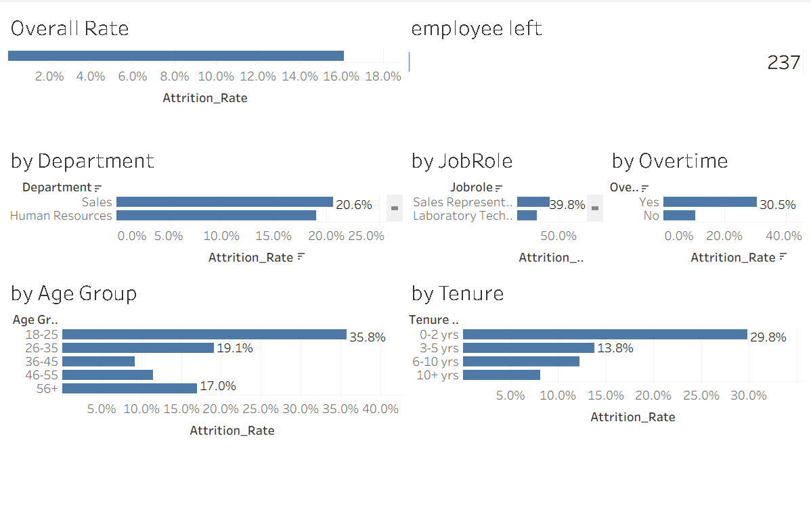

# Employee Attrition Analysis

## Overview
I analysed HR data to understand how employee attrition varies by department, job role, age, tenure, overtime and pay, using Python for cleaning, SQL for analysis, and Tableau for the dashboard.

## Business Questions
- Which departments and roles lose the most employees?
- How does attrition change with age, tsenure and pay?
- Is overtime linked to higher attrition?

## Dataset
IBM HR Analytics Employee Attrition & Performance dataset from Kaggle (https://www.kaggle.com/datasets/pavansubhasht/ibm-hr-analytics-attrition-dataset). 1,470 employees, 237 of whom left.

## Tools Used
Python (pandas), SQLite, SQL, Tableau, VS Code, Git

## Project Structure
- `data/` raw and cleaned data
- `notebooks/` data cleaning and SQL analysis
- `sql/` SQL queries
- `dashboard/` Tableau workbook
- `images/` dashboard screenshot

## Key Insights
1. **Overall attrition is 16.1%** (237 of 1,470 employees left).
2. **Overtime is the strongest signal:** 30.5% of employees working overtime left, against 10.4% of those who did not (about 2.9x). Overtime workers are 28% of staff but about 54% of leavers.
3. **Early-tenure risk:** employees with 0-2 years at the company left at 29.8% and made up about 43% of all leavers. Attrition drops to 8.1% after 10+ years.
4. **Age:** the 18-25 group has the highest attrition (35.8%), while 36-45 is the most stable (9.2%).
5. **Role:** Sales Representatives (39.8%) and Laboratory Technicians (23.9%) are the highest-risk roles and together make up about 40% of leavers. Senior roles such as Research Director (2.5%) and Manager (4.9%) are very stable.
6. **Pay:** employees earning under 3,000 per month left at 28.6%, against 8.9% for those earning 10,000 or more.
7. **Other factors:** frequent business travel (24.9%) and low job satisfaction (22.8% at level 1) are also linked to higher attrition.

**Note:** these are patterns, not proven causes, because the groups overlap. Small groups (such as Human Resources and ages 56+) should be read with care.

**Suggested actions:** review overtime workload, strengthen onboarding and support in the first two years, and look at pay and retention for Sales Representatives and Laboratory Technicians.

## Dashboard Preview

## How to Run
1. Install the packages: `python -m pip install -r requirements.txt`
2. Open `notebooks/01_clean_and_load.ipynb` and run all cells
3. Run the queries in the `sql/` folder